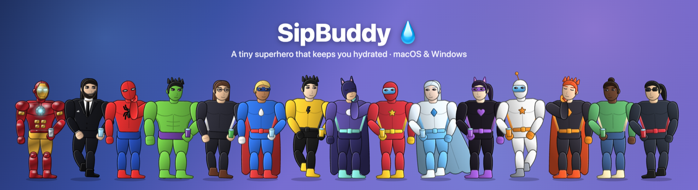
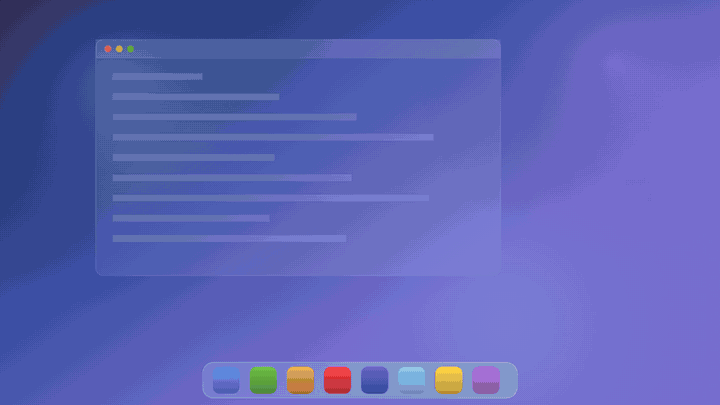
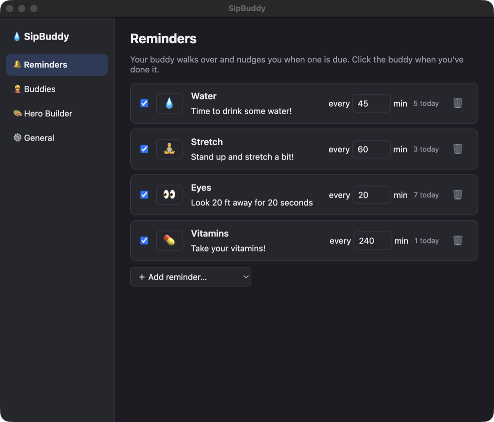
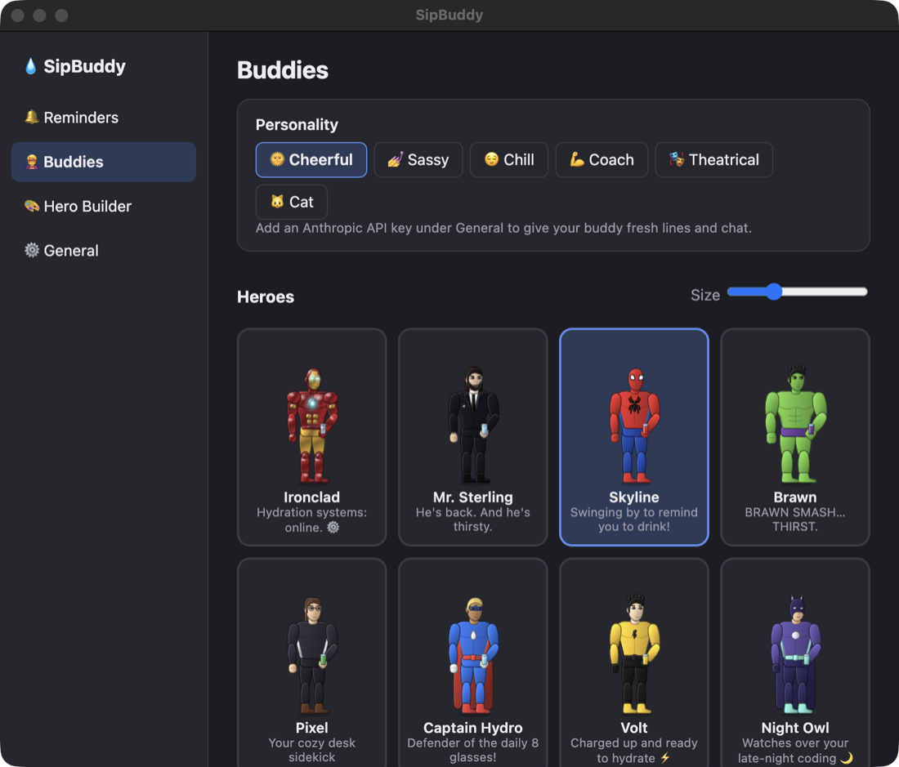
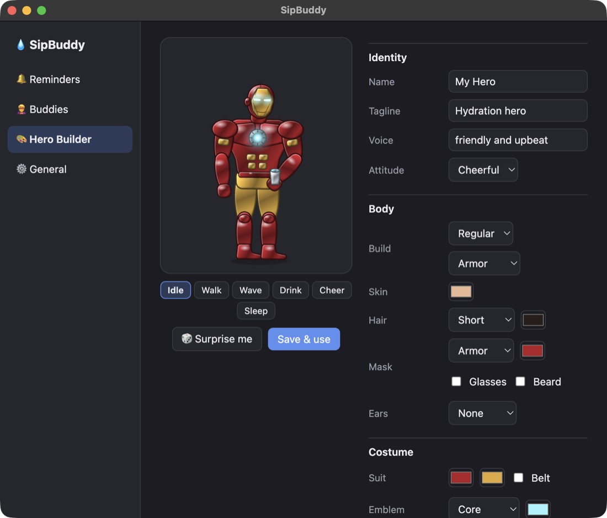
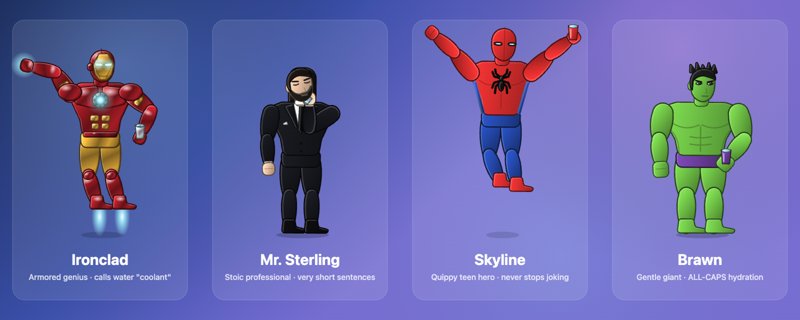
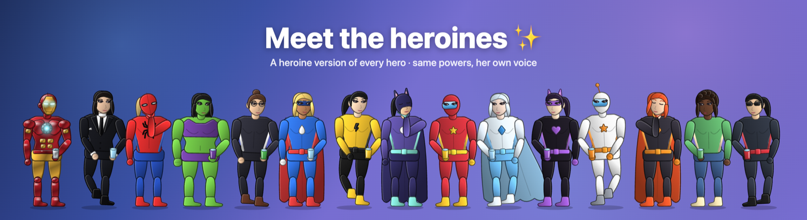

# SipBuddy 💧



A tiny animated superhero who walks along your dock or taskbar and reminds you to drink water (or stretch, rest your eyes, take meds — any reminder you like).

<p align="center">
  
  <br>
  <sub>▶️ <a href="docs/demo.mp4">Watch the demo in full quality (MP4)</a></sub>
</p>

## Download

Grab the latest build from **[Releases](../../releases/latest)**:

| Platform | File | First launch |
|---|---|---|
| **macOS 14+** (Apple Silicon) | `SipBuddy-macOS.zip` | Unzip, move to Applications, then **right-click → Open** (the app isn't notarized yet). |
| **Windows 10/11** (x64) | `SipBuddy-Setup-1.1.0.exe` | If SmartScreen warns, click **More info → Run anyway** (the installer isn't code-signed yet). |

The buddy appears above your dock or taskbar. Look for 💧 in the menu bar (macOS) or the system tray (Windows) for Settings, Pause and Quit.

## Build from source

**macOS** (native Swift + AppKit):

```sh
./build.sh            # → build/SipBuddy.app and build/SipBuddy-macOS.zip
open build/SipBuddy.app
```

Requires macOS 14+ and the Swift toolchain (Command Line Tools are enough; no Xcode project).

**Windows** (Electron, in `windows/`):

```sh
cd windows
npm install
npm start             # run it (also works on macOS for development)
npm run dist:win      # → windows/dist/SipBuddy-Setup-<version>.exe
```

The Windows app is a port of the macOS one: same 15 heroes (the renderer in `windows/src/shared/hero.js` is a line-for-line port of `HeroRig.swift`), Hero Builder, reminders, personalities, and Claude chat with reminder tools. The AI sprite Studio (selfie → animated character) is macOS-only for now.

## Screenshots

| Reminders | Pick your hero | Hero Builder |
|---|---|---|
|  |  |  |

## Using it

- **Click** the buddy when it's reminding you → marks it done (it drinks + celebrates).
- **Click** any other time → it hops and tells you when the next reminder is.
- **Drag** it anywhere → it falls back down to the dock.
- **Right-click** → Done / Snooze 10 min / Skip / Settings / Quit.
- Menu bar **💧** → upcoming reminders, today's counts, pause for 1 hour.

## Heroes (no API key needed)





30 original characters ship built in: 15 heroes and a heroine version of each.

- **Heroes:** led by **Ironclad** (the default), **Mr. Sterling**, **Skyline** and **Brawn**, then Pixel, Captain Hydro, Volt, Night Owl, Crimson Comet, Frost, Shadow Cat, Astro, Ember, Sprout and Hush.
- **Heroines:** led by **Alloy**, **Ms. Sterling**, **Skyla** and **Jade**, then Pixie, Captain Marina, Volta, Nightingale, Scarlet Comet, Flurry, Velvet, Astra, Blaze, Blossom and Whisper. Same costumes and powers, drawn with a feminine figure and face.

Each has its own voice. Pick one in **Settings → Buddies** (switch between Heroes and Heroines at the top).

They're live **vector puppets** drawn by code (`HeroRig.swift`), not sprite frames:
- **Heroic proportions:** the head is about 1/5 of the height, with broad shoulders, a tapered waist and muscular limbs.
- **Real skeleton:** shoulders, elbows, hips and knees. Drinking uses two-bone IK to bring the cup to the mouth.
- **Materials:** satin suits and shaded skin; armored heroes use polished metal with reflections, specular sheen and beveled edges, plus glowing eyes, chest core, palm repulsors, and boot thrusters on jumps.
- **Spring physics:** every joint is a damped spring, so motion has weight and overshoot.
- **Behaviors:**
  - the eyes follow your cursor and blink
  - it walks with a cape trailing behind
  - when reminding, it waves and hops
  - it drinks by tilting its head back
  - it cheers with a crouch, a jump and sparkles
  - it dozes seated with 💤 in quiet hours
  - it flails when dragged
- Calm states redraw at a lower frame rate to save battery.

**Hero Builder** lets you design your own: male or female figure, hair style, mask (domino, shades, cowl, helmet, armor, full-face), beard, body build, outfit (bodysuit, suit & tie, bare, armor), attitude, ears, cape, chest emblem, and every color, with a live animated preview and a 🎲 randomizer.

## AI

Settings → General: add an **Anthropic** key (Claude: design, QA, personality, chat) and an **OpenAI** key (gpt-image-2 painting). Both are stored in the Keychain.

### Character Studio (Settings → AI Studio, macOS)

Drop in a selfie and/or describe your buddy, then hit **Create my buddy**. The pipeline:

1. **Claude studies your look** (vision) → writes a *character bible*: name, precise appearance spec, palette, signature prop, voice.
2. **gpt-image-2 paints a hero reference** of that character (using your selfie for likeness).
3. **5 animations are painted in parallel from the hero image**: walk, idle, drink, cheer, sleep. Reusing the hero as the reference is what keeps the design consistent across sheets.
4. **Claude reviews every sheet**: it sees the hero, the raw sheet, and the exact frames the slicer extracted, then grades identity match, frame count, pose sequence and stray text. Failing sheets are repainted with Claude's fix instructions (up to 3 tries; the best-scoring attempt wins).
5. The app removes backgrounds, slices frames, and normalizes all animations to one scale and baseline.

### Personality

Pick a vibe (Cheerful, Sassy, Chill, Coach, Theatrical, Cat) or write your own. Claude writes the buddy's lines in batches ahead of time: per-reminder nags and praise, idle chatter, and sleepy lines. Reminders appear instantly and cost almost nothing, and the lines refresh when you change reminders, personality, or character.

### Chat

**Double-click** the buddy (or right-click → Talk to…) and type. It answers in character and can act on your reminders with tools:
"remind me to stretch every hour", "make water every 30 min", "I just drank water", "pause for 45 minutes", "delete posture".

You can also **Import sheet…** any hand-made PNG (row 1: walk cycle facing right, row 2: drinking).

Debug a sheet that slices badly:

```sh
.build/release/SipBuddy --slice path/to/sheet.png /tmp/frames
```

## Code map (macOS)

| File | What it does |
|---|---|
| `BuddyController.swift` | Floating window, state machine (idle / walk / remind / celebrate / drag / fall), click-through |
| `BuddyView.swift` | Draws sprite + speech bubble, mouse handling |
| `CharacterDesigner.swift` | AI pipeline: bible → hero → parallel animations → Claude QA → repaint |
| `BuddyBrain.swift` | Personality lines + chat with reminder tools (Claude) |
| `AIClients.swift` | Claude Messages API (raw HTTP) + OpenAI Images API |
| `ChatBox.swift` | Floating chat input |
| `SpriteSheet.swift` | Background removal, frame slicing, multi-sheet scale normalization |
| `Heroes.swift` | Hero look model + built-in roster |
| `HeroRig.swift` | Skeleton + IK, pose model, spring animator, pose library, hero renderer (satin / metal) |
| `AppState.swift` | Reminders, settings, daily counts |
| `SettingsView.swift` | SwiftUI settings window |

## Code map (Windows, `windows/src/`)

| File | What it does |
|---|---|
| `main.js` | Tray icon, transparent click-through buddy window above the taskbar, settings/chat windows, IPC |
| `buddy/buddy.js` | Buddy state machine, drawing, speech bubble, particles, drag/click handling |
| `shared/hero.js` | Hero roster, skeleton + IK, spring animator, pose library, canvas renderer |
| `store.js` | Reminders, settings, daily counts, saved heroes; API key encrypted with Windows DPAPI |
| `brain.js` | Personality lines + chat with reminder tools (Claude) |
| `settings/` | Settings window (Reminders, Buddies, Hero Builder, General) |

## License

MIT. The heroes are original characters, not affiliated with any comic publisher or film studio.
